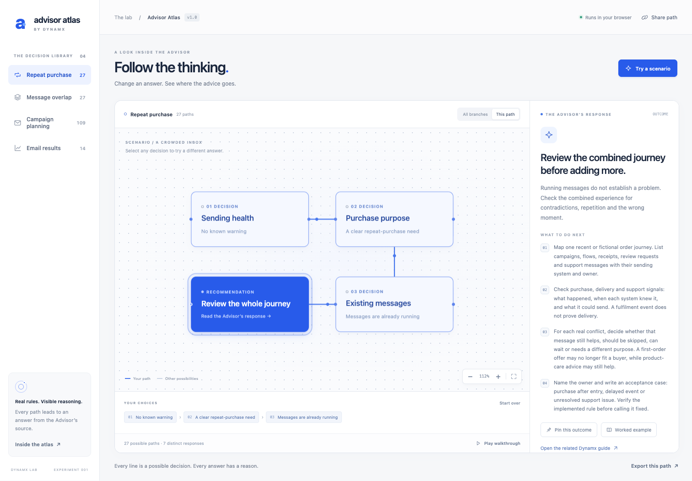

# Advisor Atlas

**Follow the thinking.** An interactive map of the real decision rules behind the Dynamx Advisor.

[Open the live demo](https://infodynamx-art.github.io/advisor-atlas/) · [GitHub repository](https://github.com/infodynamx-art/advisor-atlas)



Explore four journeys, change an earlier answer, and watch the route lead to the Advisor's exact response. Pin one outcome and compare it with another. Everything runs in the browser, with no build step, API keys or application dependencies.

## Run

Requires Node.js 22 or newer.

```sh
npm start
```

Open **http://127.0.0.1:4278**. Set `PORT` to use a different local port. The server binds only to loopback and serves this project directory. You can also serve the project root with any ordinary static HTTP server. ES modules require HTTP; opening `index.html` as a file is insufficient.

## Explore

- **Try a scenario** loads one of five fictional situations.
- **This path** makes the selected route easy to follow. Click a decision to change an answer.
- **All branches** reveals the complete compact graph. Click any node to inspect it, then use **Follow this route** to explore a real route to that node.
- **Pin this outcome** keeps a complete response for comparison. Changing earlier answers clears later choices, just as the original Advisor does. Complete a new path to compare the responses.
- **Play walkthrough** traces a scenario. It can be stopped, and reduced-motion preferences are respected.
- **Share path** copies a URL fragment containing the predefined answer choices. A localhost link works on the same machine; a hosted link can be shared.
- **Export this path** downloads the selected answers and exact recommendation as Markdown.

Keyboard users can Tab through controls and nodes, and activate them with Enter or Space. With the canvas focused, arrow keys pan, `+` / `-` zoom, and `F` fits the map. Drag empty canvas space to pan; Ctrl/Cmd + wheel zooms around the pointer.

## How the map stays accurate

The two files in `src/advisor/` are exact copies of the local Advisor content modules, identified by SHA-256 in `source-manifest.json`. `src/model.mjs` calls their exported functions directly.

The graph is built by enumerating reachable answers and combining identical future branches. A question can appear more than once when earlier answers change its consequences. Terminals are combined by their **entire response object**, so responses that reuse an internal key but differ in wording stay distinct. Shared nodes use longest-path ranks because campaign education skips the offer-terms question.

| Journey | Complete paths | Distinct responses in that journey | Graph nodes |
| --- | ---: | ---: | ---: |
| Repeat purchase | 27 | 7 | 16 |
| Message overlap | 27 | 5 | 12 |
| Campaign planning | 109 | 7 | 20 |
| Email results | 14 | 11 | 16 |

There are **177 complete paths**, **30 response variants counted within their journeys**, and **26 unique response objects across all journeys**. Counts describe the bundled snapshot.

Map labels are shortened for readability. The inspector shows the original question, reason, and recommendation steps. The one overlap-specific question introduction is preserved from the source widget. These rules provide guided educational advice; they do not inspect accounts or generate new advice.

## Test

```sh
npm test
```

The 20 Node tests verify every complete path against the source functions, all graph nodes' reachability, share-link round trips, result precedence, downstream invalidation, branch changes, exports, and source hashes.

The optional browser suite uses Playwright. With Playwright and its Chromium browser installed, start the local server, then run:

```sh
npm run test:browser
```

Optional environment variables: `ATLAS_URL` changes the test origin, `PLAYWRIGHT_MODULE` supplies an absolute path to an existing Playwright module, and `CHROME_PATH` selects an installed Chrome executable. The suite uses an isolated profile, blocks requests outside the local test origin, and saves results/screenshots under the ignored `qa/` directory.

Recorded local validation: **20 model tests + 39 browser checks passed**, including all 30 response variants and layouts at 320, 390, 1024, 1440 and 1512 pixels. Browser evidence is isolated desktop Chrome with emulated mobile viewports; physical devices, Safari and screen-reader speech were not tested.

## Files

```text
index.html                 Application shell
src/app.mjs                Map, camera, inspector and interactions
src/style.css              Responsive interface and motion
src/model.mjs              Source adapter, graph and URL state
src/advisor/               Exact original content modules
source-manifest.json       SHA-256 snapshot pins
scripts/serve.mjs          Local static preview server
tests/                    Model and browser checks
docs/preview.png           Screenshot of this app
```

## Repository and hosting

The project is published at [infodynamx-art/advisor-atlas](https://github.com/infodynamx-art/advisor-atlas). GitHub Pages serves the root of the `main` branch at [the live demo](https://infodynamx-art.github.io/advisor-atlas/). The `.nojekyll` file keeps this a plain static site. All asset paths are relative, including under the repository subpath. The source snapshot's provenance and distribution scope are documented in [SOURCES.md](SOURCES.md).

There is no analytics, cookie storage, persistent browser storage, account integration or backend. Choices live in page memory and the URL fragment. External resource links open separately. Pinning is temporary and is cleared when changing journeys or reloading.
